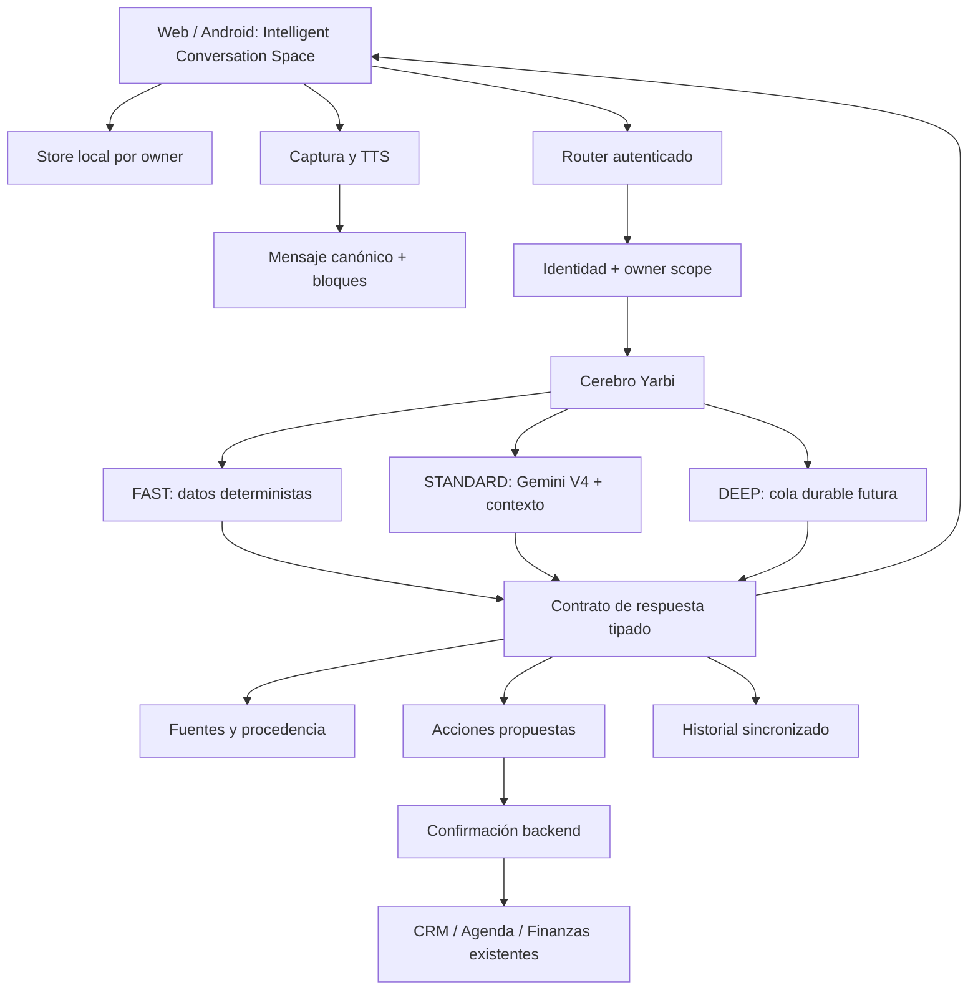

# Yarbi — Arquitectura de Conversación

## Arquitectura objetivo

## Componentes reutilizables

| Componente actual | Uso futuro | Estado |
|---|---|---|
| `api_handlers/assistant/conversation.js` | Gateway autenticado de consultas, continuidad y trazas | Reutilizable, respuesta actual plana. |
| `lib/yarbi-intelligence-router.js` | Selección FAST/STANDARD/DEEP | Reutilizable. |
| `lib/yarbi-conversation-runtime.js` | Contexto conversacional y propuestas sin ejecución | Reutilizable; requiere adaptador al contrato de bloques. |
| `lib/yarbi-conversation-continuity.js` | Token firmado de continuidad corta | Reutilizable para estado de turno, no historial. |
| `api_handlers/assistant/crm-search.js`, `crm-dossier.js` | Herramientas de CRM verificadas | Reutilizables bajo scope. |
| `lib/yarbi-finance-context.js` y Agenda | Hechos verificables para FAST | Reutilizables. |
| `frontend/yarbi-app-voice.js` | Dictado revisable al mismo recorrido de conversación | Reutilizable parcialmente. |
| `api_handlers/assistant/preferences.js` + `yarbi_conversation_messages` | Historia legacy texto plano | Migración/adaptación futura requerida. |
| `frontend/yarbi-product-completion-ui.js` | Bandeja y UI de propietario | Debe convivir, no reemplazar el chat. |

## Límites actuales

- El endpoint `conversation` está sujeto a política Preview y no es aún el
  contrato comercial definitivo.
- La respuesta actual se transporta como `reply` de texto y objetos puntuales;
  no tiene content blocks persistidos ni streaming.
- La continuidad firmada mantiene estado conversacional corto, pero no crea ni
  recupera conversaciones con título e historial completo.
- F07 dicta y revisa texto; TTS y sincronización por bloque no están cerrados.
- La migración de historial actual tiene `owner_key`, `id`, `role`, `text` y
  `message_at`; no tiene `conversation_id`, bloques, fuentes, acciones ni
  conflictos de sincronización.

## Reglas de integración

1. El adaptador de contrato se coloca después del cerebro, no duplica FAST,
   STANDARD ni DEEP.
2. El renderer acepta sólo bloques validados.
3. Las herramientas CRM/Agenda/Finanzas devuelven hechos y fuentes, no HTML.
4. Acciones siguen usando endpoints existentes y sus confirmaciones; el chat
   sólo muestra referencias de acción.
5. La ruta DEEP conserva su condición de infraestructura durable; no se
   publicita como lista sin esa dependencia.

## Compatibilidad

F03 conserva selector y scope; F04 conserva reconocimiento CRM, provenance y
confirmaciones. El contrato conversacional no altera Gemini Live, WhatsApp ni
las rutas de acción existentes.

## Business Knowledge Engine y procedencia multimedia

El BKE conserva cuatro dominios separados: originales locales Android cuando
aplique, procesamiento remoto Gemini cuando esté autorizado, conocimiento
aprobado remoto y referencias de procedencia. La deduplicación se hace por
`file_sha256` y versión de archivo; una corrección produce una versión de
conocimiento nueva y enlazada, nunca una sustitución silenciosa.

Las referencias tipadas permiten responder sin reprocesar un original: PDF
(`page`, `numeral`, `table`, `figure`), Excel (`sheet`, `cell_range`), imagen
(`region`), video (`start_ms`, `end_ms`, `frame_index`) y audio (`start_ms`,
`end_ms`). Todas conservan `file_id`, SHA-256, tipo, procedencia y extracto o
referencia sanitizada. Para preguntar la hora de un video se recupera la
referencia ya indexada; no se vuelve a analizar el video completo.

## Dependencias y puertas de etapa

| Capacidad | Puerta previa | No bloquea |
|---|---|---|
| Interfaz conversacional de Etapa 1 | Inline runs validados y jerarquía tipográfica accesible | BKE, cifrado offline, multimodalidad. |
| BKE multimedia | Referencias temporales, modelo/modalidades Gemini comprobados y límites Android medidos | Chat y CRM de Etapa 1. |
| Historial offline | Decisión documentada de persistencia, cifrado, claves, retención, borrado, sincronización y conflictos | Respuestas efímeras autenticadas. |

La evaluación técnica comparará Web/IndexedDB y Android/SQLite cifrado. El
Keystore protege claves; SQLCipher cifra la base de datos. No se equiparan.
Antes de elegir se inspeccionarán los plugins Capacitor y el árbol Android
existentes para recomendar una alternativa compatible, sin instalar
dependencias durante esta etapa.
